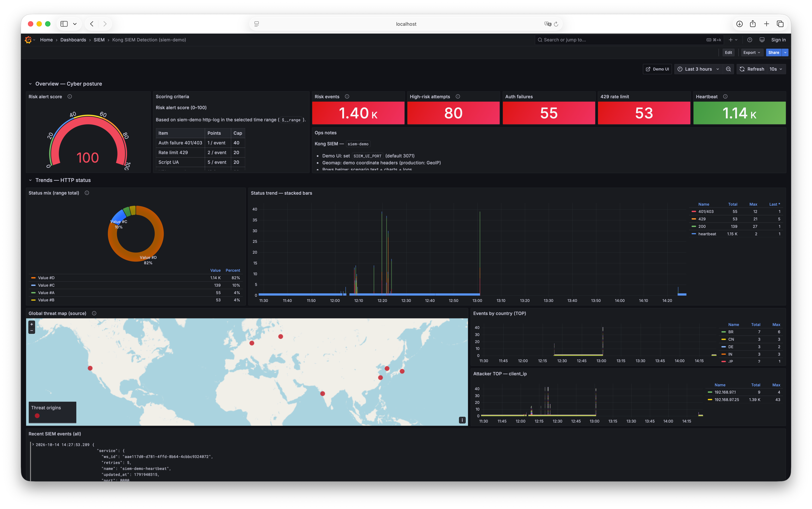

# Kong - 탐지 엔지니어링(SIEM) 가이드

English: [README.md](./README.md)

Kong Gateway API 트래픽으로 SIEM 탐지 규칙을 설계·검증하기 위한 가이드와 재현 산출물이다.

---

## 저장소 구성

```text
.
├── README.md / README_KO.md   # 본 문서
└── sample/                    # 데모·재현 산출물
    ├── deck/siem-demo.yaml    # Kong 엔티티 (select-tag: siem-demo)
    ├── logql/rules.yaml       # 규칙별 검증 임계치·LogQL
    ├── grafana/               # SIEM 대시보드 JSON
    ├── mock/                  # 업스트림 mock
    ├── ui/                    # 공격 재생·판정 UI
    ├── scripts/               # workspace / decK / verify / Grafana
    ├── images/                # 대시보드 스크린샷
    ├── docker-compose.yml     # mock + UI (Kong·Loki는 외부)
    ├── start.sh / stop.sh
    └── .env.example
```

본 저장소는 Kong CP/DP·DB·Loki·Grafana를 포함하지 않는다. 기존 Gateway·로그 파이프라인에 `sample/`을 연결한다.

---

## 전제 조건

| 항목 | 요구 |
|------|------|
| Kong Gateway | Enterprise (Admin API, Proxy). RBAC 사용 시 Admin Token |
| 로그 파이프라인 | `http-log` → 수집기(Fluent Bit 등) → SIEM 저장소 (예: Loki) |
| 도구 | `deck`, `curl`, Docker (mock/UI 실행 시), (선택) Grafana |
| 네트워크 | mock/UI 컨테이너가 Kong DP·Loki에 도달 가능한 Docker 네트워크 |

연결 정보는 `sample/.env.example`을 복사한 `sample/.env`에 둔다. 호스트·포트·토큰은 환경에 맞게 설정한다.

| 변수 | 의미 |
|------|------|
| `DECK_KONG_ADDR` | Kong Admin API |
| `KONG_ADMIN_TOKEN` | Admin Token (RBAC) |
| `KONG_PROXY_URL` | Proxy (호스트에서 curl) |
| `KONG_STATUS_URL` | Gateway readiness 확인 URL |
| `KONG_PROXY_INTERNAL` / `KONG_ADMIN_INTERNAL` | UI 컨테이너 → Kong (Docker DNS) |
| `DOCKER_NETWORK` | mock/UI가 붙는 외부 네트워크 이름 |
| `LOKI_URL` | UI → Loki |
| `GRAFANA_URL` | Grafana (대시보드 import·링크) |
| `DEMO_WORKSPACE` / `DECK_DEMO_TAG` | workspace·decK 태그 (기본 `siem-demo`) |

---

## 빠른 시작

```bash
cd sample
cp .env.example .env
# .env에 Admin/Proxy/Loki/Grafana/네트워크를 환경에 맞게 기입

# Docker 네트워크가 없으면 생성 (이름은 DOCKER_NETWORK와 동일)
docker network create "${DOCKER_NETWORK:-kong-net}" 2>/dev/null || true

./start.sh   # mock+UI 기동 → workspace → deck sync → (선택) Grafana import
./stop.sh
```

| 항목 | 기본 |
|------|------|
| Demo UI | `http://127.0.0.1:${SIEM_UI_PORT:-3071}` |
| Workspace | `siem-demo` |
| Consumer key | `siem-good-key` |
| SIEM dashboard | `${GRAFANA_URL}/d/kong-siem-detection` |

UI에서 규칙별 Run / Evaluate 또는 혼합 실행 후 Grafana에서 확인한다.

decK만 적용할 때:

```bash
cd sample && ./scripts/deck-sync.sh
```

---

## 목적

Kong을 통과하는 API 트래픽으로 다음을 SIEM에서 탐지한다.

- 인증 실패 폭주·실패 후 성공
- 인가 우회 의심(BOLA·ID 순회)
- 한도 초과·봇·URI 공격 시그니처
- 대량 조회·유출
- 정책·텔레메트리 공백

규칙 카드는 **WHEN / GROUP·RELATE BY / WITHIN / THEN** 형식을 따른다.  
본 문서의 LogQL은 **Loki 환경 예시**이다. 조직 SIEM(Splunk, Elastic, Chronicle 등)에는 동일 논리로 필드 매핑하면 된다.

금융 API의 BOLA·키 스터핑·Consumer 기준 대량 조회는 웹·WAF 중심 원문 규칙에 그대로 없으므로, **동일 카드 서식에 Kong 신호를 붙인 확장 규칙**이다.

---

## 적용 범위

| 구분 | 내용 |
|------|------|
| 텔레메트리 | Workspace·글로벌 `http-log`(또는 `file-log`) JSON, (선택) Prometheus `kong_*` / RLA 헤더, OTel, Admin/decK 설정 dump |
| 비범위 | 앱 서버 내부 인가 로직 자체 구현, EDR·AD 전용 규칙 (교차 연관만 언급) |
| 시나리오 | 금융권 API 인가 결함·크리덴셜 스터핑·대량 조회 유형 |
| 설정 예시 | 아래 **decK 상태 예시**, **Loki·LogQL 예시**, **Grafana 대시보드 예시** |

---

## 아키텍처 개요

```text
Client / 검증 트래픽
      │
      ▼
Kong DP  ── http-log JSON ──► Fluent Bit ──► Loki
      │                                        │
      ▼                                        ▼
Upstream API                         Grafana SIEM Dashboard
```

| 계층 | 역할 |
|------|------|
| Kong | 인증·인가·한도·봇 탐지 + 구조화 로그 송출 |
| Fluent Bit | `http-log` HTTP 수신 → Loki push |
| Loki | 라벨·JSON 파싱·집계 (SIEM 저장소 예시) |
| Grafana | 전체 현황·규칙별 시나리오 패널 |

**Workspace 격리:** `default` workspace의 글로벌 `http-log`는 다른 workspace 트래픽을 포함하지 않는다. 민감 API가 별도 workspace에 있으면 그 workspace에 `http-log`를 둔다.

---

## Kong 텔레메트리

### 권장 Plugin 조합

| Plugin | 역할 | 탐지 신호 |
|--------|------|-----------|
| `http-log` / `file-log` | 요청·응답 메타를 SIEM으로 전송 | 아래 필드 전부 |
| `openid-connect` / `key-auth` / `jwt` | 인증 강제 | 401/403, consumer 없음 |
| `acl` / Consumer Group | 라우트·스코프 인가 | 403, 허용되지 않은 consumer |
| `rate-limiting-advanced` | 호출 한도 | 429, remaining 급감 |
| `bot-detection` | 자동화 클라이언트 | 차단·점수·UA 이상 |
| `ip-restriction` | 출발지 통제 | 403, 해외·비허용 IP |
| `request-validator` | 파라미터·스키마 | 400, 검증 실패 급증 |
| `prometheus` | 집계 메트릭 | RPS, 4xx/5xx, latency · http-log EPS 보조 |

차단 Plugin이 없어도 `http-log`만으로 이상 패턴은 잡을 수 있다. 한도·인가를 켠 뒤 남는 예외를 탐지하는 편이 오탐이 적다.

### http-log JSON 주요 필드

```json
{
  "client_ip": "203.0.113.10",
  "started_at": 1791254136957,
  "request": {
    "method": "GET",
    "uri": "/loan/solicitor/v1/customers/39561234",
    "size": 512,
    "headers": { "user-agent": "python-requests/2.32" }
  },
  "response": { "status": 200, "size": 48200 },
  "latencies": { "request": 120, "kong": 3, "proxy": 110 },
  "consumer": { "id": "…", "username": "solicitor-app-01", "custom_id": "SOL-001" },
  "route": { "name": "loan-solicitor-inquiry", "paths": ["/loan/solicitor"] },
  "service": { "name": "loan-inquiry-api" },
  "upstream_status": "200"
}
```

| SIEM 논리 필드 | Kong http-log 경로 | 용도 |
|----------------|-------------------|------|
| `src_ip` | `client_ip` | 출발지·지리적 이상 |
| `http.method` / `http.path` | `request.method` / `request.uri` | 경로·ID 변조 |
| `http.status` | `response.status` 또는 `upstream_status` | 401/403/429/200 |
| `bytes_out` | `response.size` | 대량 응답·유출 |
| `user` / `consumer` | `consumer.username` / `custom_id` | 신원 기준 집계 |
| `ua` | `request.headers.user-agent` | 봇·스크립트 |
| `route` / `service` | `route.name` / `service.name` | 자산·중요도 |
| `req_id` | `request.id` 또는 `correlation_id` / `X-Request-ID` | 조사 타임라인 |

SIEM 집계는 헤더 `x-consumer-*`보다 본문 `consumer` 객체를 우선한다.

Fluent Bit가 Loki로 넣을 때 JSON이 펼쳐지면 아래처럼 쓰는 경우가 많다.

| http-log | Loki `| json` 후 필드(예시) |
|----------|------------------------|
| `client_ip` | `client_ip` |
| `response.status` | `response_status` |
| `route.name` | `route_name` |
| `request.uri` | `request_uri` |
| `consumer.username` | `consumer_username` |
| `response.size` | `response_size` |

---

## 공통 운영 기준

### 규칙 로직 네 요소

| 요소 | 의미 | Kong 적용 |
|------|------|-----------|
| **WHEN** | 관찰 조건 | status, path 패턴, bytes, UA, 한도 헤더 |
| **GROUP / RELATE BY** | 묶는 개체 | `consumer` · `client_ip` · `route.name` |
| **WITHIN** | 시간창 | 5분 / 15분 / 1시간 (업무 기준선 후 조정) |
| **THEN** | 경보·상향 | 심각도, 티켓, Consumer 제한, IP 차단 |

**위협 가설:**  
「조직에서 [탐지 조건]의 패턴이 관찰되면 매핑된 공격 행위이거나 조사가 필요한 주요 전조일 수 있음」

튜닝: 기준선 측정 → 좁은 예외 → 예외 만료일.  
조사: 텔레메트리 정상 → 주 개체 식별 → 조건 확인 → ±30분 타임라인 → 연관 확대 → 전후 공격 단계 → 정·오탐 분류.

### 대응 유형

| 유형 | 의미 | Kong API 사고 시 후속 |
|------|------|----------------------|
| **A** 계정·세션형 | 세션·자격증명 폐기 | Consumer 키/토큰 롤오버, IdP 세션 폐기, 동일 자격증명 재사용 검색 |
| **F** 웹·취약점형 | WAF·서비스 제한 | Route 임시 한도·IP 차단, 앱 인가(BOLA) 티켓, 증거용 http-log 보존 |
| **I** 데이터 유출형 | 전송 제한·영향 평가 | RLA 0·Consumer 비활성, `sum(response.size)`·건수로 유출 규모 추정 |
| **J** 탐지 상태형 | 텔레메트리 복구 | http-log/Fluent/Loki 복구, 사각 구간 소급 헌팅 |
| **C** 공격 체인형 | 단계 묶음 케이스 | 001→001b→002/005를 단일 사고로 병합 |

기본은 **F + I**, Consumer 탈취가 보이면 **A**, 로그 단절이면 **J**, 다단계면 **C**를 병행한다.

### 안전 검증 기대 결과

1. 필요한 텔레메트리(`http-log` 등)가 수집됨  
2. 탐지가 정확히 1회 일치함  
3. 보강 필드(`consumer`, `route`, `client_ip` 등)가 채워짐  
4. 분석가가 타임라인을 구성할 수 있음  
5. 테스트 태그가 붙어 실제 사고와 혼동되지 않음  

### 모의 타임라인

| 유형 | 적용 규칙 | 흐름 예 |
|------|-----------|---------|
| 인증형 | 001, 001b, 007 | 잘못된 키 호출 → 401 폭주/실패→성공 → SIEM이 Consumer·Route로 보강 |
| 엔드포인트형(앱) | 002, 004, 008 | 민감 Route 첫 로그 → ID 순회·UA 이상 → distinct ID·bytes로 확장 |
| 연관 분석형 | 005, 007, 009 | 인증 실패 → 대량 200 → 체인 케이스 1건 |

---

## 공격 단계 ↔ Kong 탐지 규칙 매핑

| 단계 | 위협 요약 | Kong 규칙 |
|------|-----------|-----------|
| 1a. 인증 폭주 | 동일 IP의 키·토큰 대입 | KG-API-001 |
| 1b. 실패 후 성공 | 연속 401 뒤 동일 IP/계정 200 | KG-API-001b |
| 2. 인가 결함 | 고객번호 변조 조회 (BOLA) | KG-API-002 |
| 3. 자동화·폭주 | 스크립트 UA·해외 IP·한도 근접 | KG-API-003, 004, 008 |
| 4. 대량 유출 | 동일 Consumer 대용량·고건수 200 | KG-API-005 |
| 5a. 통제 공백 | 민감 Route에 인증·한도 없음 | KG-API-006 |
| 5b. 로그 단절 | 민감 Route http-log EPS=0 | KG-API-009 |
| 6. 교차 연관 | 401 폭주 직후 대량 200 | KG-API-007 |

---

## 규칙 카드

운영 카드의 WITHIN·임계치는 업무 기준선 후 조정한다.  
아래 **Loki LogQL 예시**는 검증용으로 윈도를 짧게(2~5분) 둔 값이다.

### KG-API-001 인증 실패 폭주 (크리덴셜 스터핑·키 대입)

| 항목 | 내용 |
|------|------|
| 영역 | 계정·인증 |
| 대응 유형 · 타임라인 | **A**, 인증형 |
| ATT&CK | T1110 Brute Force |
| 심각도·윈도 | 높음, **5분** (운영) / 검증 예 **2분·≥10건** |
| 텔레메트리 | Kong `http-log` |
| 주요 필드 | `client_ip`, `response.status`, `request.uri`, `consumer`, `request.headers.user-agent`, `route.name` |
| **WHEN** | 동일 `client_ip`(또는 동일 `route`)에서 `response.status in (401, 403)` 건수가 기준선 초과 (예: 5분에 ≥ 50). `consumer` null 비중이 높으면 우선 |
| **GROUP BY** | `client_ip` + `route.name` |
| **THEN** | 높음 경보. 직후 동일 IP에서 성공이 이어지면 KG-API-001b·007로 상향 |
| 관련 Plugin | `openid-connect` / `key-auth`, `bot-detection`, `ip-restriction` |
| 튜닝 포인트 | 헬스체크·모니터링 IP 제외. 배포 직후 키 만료 401은 변경 창과 연계 |
| 안전 검증 | 잘못된 키 N회 호출 → 경보 1회·테스트 태그 |

```text
WHEN count(status IN {401,403}) BY client_ip, route.name
WITHIN 5m
THRESHOLD >= baseline * 3 OR >= 50
THEN alert high "kong_auth_failure_burst"
```

**LogQL 예시 (Loki)**

```logql
sum by (client_ip) (
  count_over_time(
    {log_source="http-log"}
    | json
    | route_name = "siem-demo-customers-route"
    | response_status = "401" or response_status = "403"
    | __error__ = ""
    [2m]
  )
)
```

판정: 시리즈 값이 ≥ 10 이면 탐지(검증 임계치).

---

### KG-API-001b 인증 실패 후 성공 (탈취·우회 전조)

| 항목 | 내용 |
|------|------|
| 영역 | 계정·인증 |
| 대응 유형 · 타임라인 | **A**, 인증형 |
| ATT&CK | T1110, T1078 |
| 심각도·윈도 | 높음, **10분** (운영) / 검증 예 **3분·실패 ≥3 후 200** |
| **WHEN** | 동일 `client_ip`(또는 동일 `consumer` 후보)에서 연속 `401/403` 후 같은 윈도 안 `status=200`이 동일 민감 `route`에 발생 |
| **RELATE BY** | `client_ip` → 성공 시점의 `consumer` |
| **THEN** | 높음. 이어지는 ID 순회·대용량이면 KG-API-007 |
| 관련 Plugin | 인증 Plugin + `http-log` |
| 튜닝 포인트 | 정상 키 로테이션·재시도 게이트웨이 억제 |
| 안전 검증 | 가상 실패 이벤트 후 성공 1건 재생 → 연관 케이스 1건 |

```text
WHEN auth_failures(ip) AND success(ip, route) WITHIN 10m
THEN alert high "kong_auth_fail_then_success"
```

**LogQL 예시 (시퀀스 조사)**

```logql
# 실패
{log_source="http-log"} |= `/loan/customers`
  | json
  | response_status = "401" or response_status = "403"

# 성공 (동일 client_ip로 Explore에서 교차)
{log_source="http-log"} |= `/loan/customers`
  | json
  | response_status = "200"
```

동일 `client_ip`에 실패 스트림이 먼저 쌓인 뒤 200이 이어지면 001b로 판정한다. (시퀀스 상관은 SIEM 룰·상관 엔진이 담당)

---

### KG-API-002 리소스 ID 고속 순회 (BOLA·인가 결함 의심)

| 항목 | 내용 |
|------|------|
| 영역 | 웹·애플리케이션 / 수집 |
| 대응 유형 · 타임라인 | **F** (+ 확인 시 **A**), 엔드포인트형(앱) |
| ATT&CK | T1190 (공개면 API 악용 맥락), 민감 열람은 T1005/T1213에 준하는 API 행위 |
| 심각도·윈도 | **심각**, **10분** (운영) / 검증 예 **2분·distinct ID ≥12** |
| **WHEN** | 동일 `consumer`(없으면 `client_ip`)가 짧은 시간에 서로 다른 리소스 ID를 다수 조회. 예: `/customers/{id}`에서 distinct `{id}` ≥ 30 / 10분 이고 `status=200` 비율이 높음 |
| **GROUP BY** | `consumer.username` (없으면 `client_ip`) + `route.name` |
| **THEN** | 심각. 앱 객체 인가 교차검증 티켓 (대응 F) |
| 관련 Plugin | `acl`, OPA/정책 플러그인, `request-validator`, Rate Limit |
| 튜닝 포인트 | 배치·정산 Consumer는 별도 한도·허용 목록. Path 정규식으로 ID 세그먼트 추출 |
| 안전 검증 | 테스트 Route에 연속 더미 ID 조회 재생 |

```text
WHEN distinct_count(extract_id(request.uri)) BY consumer
     WHERE status = 200 AND route IN sensitive_routes
WITHIN 10m
THRESHOLD >= 30
THEN alert critical "kong_bola_id_enumeration"
```

**LogQL 예시 (원본 스트림 + ID 추출용 패턴)**

```logql
{log_source="http-log"} |= `/loan/customers`
  | json
  | response_status = "200"
  | regexp `/customers/(?P<resource_id>[^/?]+)`
```

SIEM에서 `resource_id`의 `count_distinct`를 `client_ip` 또는 `consumer_username`별로 집계한다.

---

### KG-API-003 Rate Limit 근접·초과 (자동화 수집)

| 항목 | 내용 |
|------|------|
| 영역 | 웹·애플리케이션 |
| 대응 유형 · 타임라인 | **F**, 엔드포인트형(앱) |
| ATT&CK | T1110 (자동화 대입·남용 맥락) |
| 심각도·윈도 | 높음, **15분** (운영) / 검증 예 **2분·429 ≥1** |
| 텔레메트리 | `http-log` + 응답 헤더 `X-RateLimit-*` / `RateLimit-*` |
| **WHEN** | (a) `status=429`가 Consumer·IP당 기준 초과, 또는 (b) remaining이 한도의 10% 미만인 200이 지속 |
| **GROUP BY** | `consumer` / `client_ip` |
| **THEN** | 높음. 한도 없는 Route면 KG-API-006과 연관 |
| 관련 Plugin | `rate-limiting-advanced` (`identifier: consumer`) |
| 튜닝 포인트 | 영업 마감 피크 기준선. NAT IP는 Consumer 기준 우선 |
| 안전 검증 | 테스트 Consumer로 한도 초과 호출 → 429·경보 1회 |

**LogQL 예시**

```logql
sum(count_over_time(
  {log_source="http-log"} |= `/loan/customers`
  | json
  | response_status = "429"
  [2m]
))
```

---

### KG-API-004 봇·스크립트 UA + 해외 IP + 민감 Route

| 항목 | 내용 |
|------|------|
| 영역 | 웹·앱 / 네트워크 |
| 대응 유형 · 타임라인 | **F** (+ **E** IOC 차단 시), 엔드포인트형(앱) |
| ATT&CK | T1071, T1110 |
| 심각도·윈도 | 높음, **15분** |
| **WHEN** | 민감 `route`에 스크립트·비브라우저 UA(`python-requests`, `curl`, 빈 UA)이거나 `bot-detection` 차단이 발생하고, `client_ip`가 비허용 국가·ASN |
| **GROUP BY** | `client_ip` + `route.name` |
| **THEN** | 높음. KG-API-002·005와 겹치면 심각 상향 |
| 관련 Plugin | `bot-detection`, `ip-restriction`, `openid-connect` |
| 튜닝 포인트 | 승인 배치 UA·고정 출구 IP는 서명된 예외 |
| 안전 검증 | 비허용 UA·테스트 GeoIP로 민감 Route 호출 |

**LogQL 예시**

```logql
{log_source="http-log"} |= `/loan/customers`
  | json
  | line_format `{{.request_headers_user_agent}}`
  |~ `(?i)(python-requests|curl|siem-bot)`
```

운영에서는 GeoIP enrichment 후 비허용 `country`/`asn`과 AND 한다.

---

### KG-API-005 동일 신원 대용량·고건수 성공 응답 (유출)

| 항목 | 내용 |
|------|------|
| 영역 | 데이터 수집·유출 |
| 대응 유형 · 타임라인 | **I** (+ **A**), 연관 분석형 |
| ATT&CK | T1005에 준하는 API 경유 수집 |
| 심각도·윈도 | **심각**, **30분** (운영) / 검증 예 **3분·건수 ≥5 또는 bytes 합 ≥400KB** |
| **WHEN** | 동일 `consumer`가 민감 Route에서 `status=200` 이고 (a) 건수 ≥ 기준 또는 (b) `sum(response.size)` ≥ 기준 (예: 30분에 50MB 또는 건수 500) |
| **GROUP BY** | `consumer.username` + `route.name` |
| **THEN** | 심각. 자격증명 폐기·한도 0 (I+A) |
| 관련 Plugin | Rate Limit, 응답 마스킹(예방), `http-log` |
| 튜닝 포인트 | 리포트·정산 배치 Consumer는 용량 기준 분리. size와 건수 AND |
| 안전 검증 | 테스트 Consumer로 더미 대용량 응답 반복 호출 |

```text
WHEN sum(response.size) BY consumer, route
     WHERE status = 200 AND route IN pii_routes
WITHIN 30m
THRESHOLD >= 50MB OR count >= 500
THEN alert critical "kong_mass_exfil_via_api"
```

**LogQL 예시 (건수)**

```logql
sum by (consumer_username) (
  count_over_time(
    {log_source="http-log"} |= `/loan/customers`
    | json
    | response_status = "200"
    [3m]
  )
)
```

용량 합은 SIEM에서 `response_size`를 `sum`한다. Loki만으로도 unwrap 후 `sum_over_time`이 가능하다.

```logql
sum by (consumer_username) (
  sum_over_time(
    {log_source="http-log"} |= `/loan/customers`
    | json
    | response_status = "200"
    | unwrap response_size [3m]
  )
)
```

---

### KG-API-006 민감 Route 통제 공백 (구성·노출)

| 항목 | 내용 |
|------|------|
| 영역 | 취약점·노출 — 설정 결함 |
| 대응 유형 · 타임라인 | **F** (구성 조치), 엔드포인트형(앱) |
| 심각도·윈도 | 높음, **일 배치 또는 설정 변경 시** |
| 텔레메트리 | Admin API dump, decK state, CP 감사 로그 (**트래픽 로그 아님**) |
| **WHEN** | 민감 `paths`·태그인데 인증(`key-auth`/`openid-connect`/`jwt` 중 1) 또는 `rate-limiting*`가 없음 |
| **THEN** | 높음(구성 결함). 트래픽 경보 전에 구멍 차단 |
| 관련 Plugin | CI decK lint / 정책 가드 |
| 안전 검증 | 스테이징에 의도적 공백 Route를 만들고 스캔 1건 확인 |

**판정 논리 (설정 스캔)**

```text
민감 paths·태그 ∩ (key-auth|openid-connect|jwt|basic-auth 없음
                 OR rate-limiting|rate-limiting-advanced 없음) → 경보
```

예시 path 부분문자열: `/loan`.  
아래 decK에서 `/siem-demo/loan/open` Route가 의도적 공백이다.

---

### KG-API-007 교차 연관: 인증 이상 후 성공적 대량 조회

| 항목 | 내용 |
|------|------|
| 영역 | 교차 소스 연관 |
| 대응 유형 · 타임라인 | **C** + **A** + **I**, 연관 분석형 |
| ATT&CK | T1110 → T1078 → 수집(T1005 준하는 API) |
| 심각도·윈도 | **심각**, **30분** (앞 이벤트 기준) / 검증 예 **5분** |
| **WHEN** | 동일 `client_ip`(또는 이후 동일 `consumer`)에서 KG-API-001 또는 001b 충족 후 30분 이내 KG-API-002 또는 KG-API-005 충족 |
| **RELATE BY** | `client_ip` → (인증 성공 시) `consumer` |
| **THEN** | 심각. 자격증명 폐기·IP 차단·Route 임시 한도. 단일 사고 케이스로 병합 |
| 안전 검증 | 실패 폭주 → 성공 → 더미 ID 순회를 한 타임라인으로 재생 |

```text
WHEN (auth_burst(ip) OR fail_then_success(ip))
 AND within 30m mass_success(ip OR consumer_bound_to_ip)
THEN alert critical "kong_stuffing_then_exfil_chain"
```

**LogQL 조합:** KG-API-001 쿼리 결과 IP와 KG-API-005 쿼리 결과 IP/consumer를 동일 윈도에서 교집합한다.

---

### KG-API-008 URI·파라미터 공격 시그니처 (Traversal·메타문자)

| 항목 | 내용 |
|------|------|
| 영역 | 웹·WAF·애플리케이션 |
| 대응 유형 · 타임라인 | **F**, 엔드포인트형(앱) |
| ATT&CK | T1190, (메타문자 시) T1059 맥락 |
| 심각도·윈도 | 높음~심각, **5분** |
| **WHEN** | `request.uri`·쿼리에 `../`, `%2e%2e`, 셸 메타문자·인젝션 유사 패턴이 있거나 `request-validator` 400이 동일 IP에서 급증. 성공(200)·대용량 응답이면 심각 상향 |
| **GROUP BY** | `client_ip` + `route.name` |
| **THEN** | 높음/심각. WAF·IP 차단·앱 점검 (F) |
| 관련 Plugin | `request-validator`, (선택) WAF/OPA, `http-log` |
| 튜닝 포인트 | 정상 인코딩 URL·승인 스캐너 제외 |
| 안전 검증 | 민감 데이터 없는 테스트 경로에 무해한 traversal 유사 문자열 |

**LogQL 예시**

```logql
sum(count_over_time(
  {log_source="http-log"} |= `/siem-demo/`
  |~ `(?i)(\.\./|%2e%2e|\.\.%2f)`
  [2m]
))
```

---

### KG-API-009 민감 Route http-log 전송 중단 (탐지 상태)

| 항목 | 내용 |
|------|------|
| 영역 | 탐지 체계 상태·텔레메트리 |
| 대응 유형 · 타임라인 | **J**, 엔드포인트형(앱) |
| ATT&CK | T1562.001 (방어 무력화·가시성 상실 맥락) |
| 심각도·윈도 | **심각**, **10분** (운영) / 검증 예 **2분·기대 EPS=0 지속 ≥15초** |
| 텔레메트리 | SIEM·Loki의 Kong http-log EPS, 포워더 하트비트 |
| **WHEN** | Proxy/Admin은 정상이데 민감 `route`·워크스페이스의 `http-log` 수신이 기대치 대비 0건(또는 급락) |
| **GROUP BY** | `route.name` / `workspace` / 수집 파이프라인 |
| **THEN** | 심각(상태). 플랫폼 팀 복구 + 사각 구간 소급 헌팅 (J) |
| 튜닝 포인트 | 저트래픽 Route는 하트비트·합성 프로브와 구분 |
| 안전 검증 | 스테이징 포워더만 일시 중지 또는 0건 지표 재생 |

**LogQL 예시 (하트비트 경로 EPS)**

```logql
sum(count_over_time(
  {log_source="http-log"} |= `/siem-demo/heartbeat`
  [2m]
))
```

값이 0이고 Proxy 헬스체크는 정상이면 009 탐지.

---

## decK 상태 예시

아래는 탐지 신호를 만들기 위한 Kong 설정 예시이다 (`sample/deck/siem-demo.yaml`).  
태그 `siem-demo`로 격리하고, `--select-tag siem-demo`로 sync한다.

| Path | Plugin | 규칙 |
|------|--------|------|
| workspace 글로벌 | `http-log` → Fluent Bit | 전 규칙 텔레메트리 |
| `/siem-demo/loan/customers` | key-auth, acl, RLA, bot-detection | 001~005, 007, 008 |
| `/siem-demo/loan/open` | 없음 (의도적 공백) | 006 |
| `/siem-demo/heartbeat` | 없음 | 009 (합성 EPS) |

```yaml
_format_version: "3.0"
_info:
  select_tags:
    - siem-demo

# Workspace-scoped http-log
# (default workspace 글로벌 플러그인은 다른 workspace를 커버하지 않음)
plugins:
  - name: http-log
    tags: [siem-demo]
    config:
      http_endpoint: http://fluent-bit:8888
      method: POST
      content_type: application/json
      timeout: 10000
      keepalive: 60000
      queue:
        max_batch_size: 1
        max_coalescing_delay: 1

consumers:
  - username: siem-good
    tags: [siem-demo]
    keyauth_credentials:
      - key: siem-good-key
        tags: [siem-demo]
    acls:
      - group: group-siem-loan
        tags: [siem-demo]

services:
  - name: siem-demo-loan
    url: http://siem-demo-mock:8080   # 운영: 실제 업스트림 URL
    tags: [siem-demo]
    routes:
      - name: siem-demo-customers-route
        tags: [siem-demo]
        paths: [/siem-demo/loan/customers]
        strip_path: true
        methods: [GET]
        protocols: [http, https]
        plugins:
          - name: key-auth
            tags: [siem-demo]
            config:
              key_names: [apikey]
              hide_credentials: true
          - name: acl
            tags: [siem-demo]
            config:
              allow: [group-siem-loan]
          - name: rate-limiting-advanced
            tags: [siem-demo]
            config:
              limit: [25]              # 검증용. 운영은 기준선 후 조정
              window_size: [60]
              identifier: consumer
              namespace: siem-demo-customers
              sync_rate: -1
              strategy: local          # 다중 DP면 redis 등
          - name: bot-detection
            tags: [siem-demo]

      # KG-API-006 — 민감 path인데 인증·한도 없음
      - name: siem-demo-open-route
        tags: [siem-demo]
        paths: [/siem-demo/loan/open]
        strip_path: true
        methods: [GET]
        protocols: [http, https]

  - name: siem-demo-heartbeat
    url: http://siem-demo-mock:8080
    tags: [siem-demo]
    routes:
      - name: siem-demo-heartbeat-route
        tags: [siem-demo]
        paths: [/siem-demo/heartbeat]
        strip_path: true
        methods: [GET]
        protocols: [http, https]
```

### 적용 명령 예시

```bash
# Workspace 생성 (없으면)
curl -sS -X POST ${DECK_KONG_ADDR}/workspaces \
  -H "Kong-Admin-Token: ${KONG_ADMIN_TOKEN}" \
  -H "Content-Type: application/json" \
  -d '{"name":"siem-demo","comment":"API SIEM detection"}'

deck gateway validate sample/deck/siem-demo.yaml \
  --kong-addr ${DECK_KONG_ADDR} \
  --workspace siem-demo \
  --headers "Kong-Admin-Token: ${KONG_ADMIN_TOKEN}"

deck gateway sync sample/deck/siem-demo.yaml \
  --kong-addr ${DECK_KONG_ADDR} \
  --workspace siem-demo \
  --headers "Kong-Admin-Token: ${KONG_ADMIN_TOKEN}" \
  --select-tag siem-demo \
  --parallelism 1
```

태그 없이 sync하면 다른 스택 설정이 삭제될 수 있다.

### 트래픽 스모크

```bash
# 정상 (200)
curl -sS -H 'apikey: siem-good-key' \
  ${KONG_PROXY_URL}/siem-demo/loan/customers/1001

# 인증 실패 (401) — KG-API-001 원천
for i in $(seq 1 12); do
  curl -sS -o /dev/null -w "%{http_code}\n" \
    -H "apikey: bad-$i" \
    ${KONG_PROXY_URL}/siem-demo/loan/customers/x
done

# 통제 공백 Route — KG-API-006 대상
curl -sS ${KONG_PROXY_URL}/siem-demo/loan/open/info

# Heartbeat — KG-API-009 기대 EPS
curl -sS ${KONG_PROXY_URL}/siem-demo/heartbeat
```

운영 Plugin 스케치(OIDC·validator 포함)는 민감 Route에 아래를 추가하는 형태다.

```yaml
- name: openid-connect
  config: { }   # issuer, auth_methods …
- name: request-validator
  config: { }   # customer_id 스키마
```

---

## Loki 환경 예시

### 수집 경로

```text
Kong http-log POST → Fluent Bit (:8888) → Loki (:3100)
```

| Label | 값 | 용도 |
|-------|-----|------|
| `job` | `kong-dp` | DP 구분 |
| `log_source` | `http-log` | 플러그인 출처 필터 |

공통 셀렉터:

```logql
{log_source="http-log"}
```

민감 path 필터:

```logql
{log_source="http-log"} |= `/siem-demo/loan/customers` | json
```

### 규칙별 검증 임계치 요약

운영 카드보다 짧은 윈도·낮은 임계치(검증용).

| ID | lookback | 판정 요지 |
|----|----------|-----------|
| 001 | 2m | 401/403 ≥ 10 (동일 route) |
| 001b | 3m | 실패 ≥3 후 동일 route 200 |
| 002 | 2m | distinct customer ID ≥ 12, status 200 |
| 003 | 2m | 429 ≥ 1 |
| 004 | 2m | UA에 python-requests / curl / siem-bot |
| 005 | 3m | 200 건수 ≥5 또는 bytes 합 ≥ 400000 |
| 006 | (배치) | 민감 path에 auth 또는 RLA 부재 |
| 007 | 5m | 001 후 005 체인 |
| 008 | 2m | URI에 `../` · `%2e%2e` 등 |
| 009 | 2m | heartbeat 경로 건수 0, Proxy up |

### Grafana Explore용 빠른 쿼리

```logql
# 전체 SIEM 이벤트
{log_source="http-log"} |= `/siem-demo/`

# 인증 실패
{log_source="http-log"} |= `/siem-demo/loan/customers`
  | json
  | response_status=`401` or response_status=`403`

# 한도 초과
{log_source="http-log"} |= `/siem-demo/loan/customers`
  | json
  | response_status=`429`

# URI traversal
{log_source="http-log"} |= `/siem-demo/` |~ `(?i)(\.\./|%2e%2e)`

# Heartbeat
{log_source="http-log"} |= `/siem-demo/heartbeat`
```

---

## Grafana 대시보드 예시

대시보드 UID 예: `kong-siem-detection`  
데이터소스: Loki (`uid: loki`)  
시간 범위: 최근 15분~1시간 (검증 트래픽 재생 후)

구성은 **전체 현황** + **규칙(KG-API)별 시나리오** 두 층이다.

### 패널 구성

| 구역 | 패널 | 설명 |
|------|------|------|
| 전체 현황 | 위기 경보 점수 (0–100) | 401/403·429·스크립트 UA·URI 시그니처 가점·상한 |
| 전체 현황 | 위험 이벤트 / 고위험 시도 | 기간 합계 Stat |
| 전체 현황 | 인증 실패 · 429 · Heartbeat | KPI |
| 전체 현황 | 유형별 추이 (status) | 타임시리즈·스택 막대 |
| 전체 현황 | 글로벌 위협 맵 | Geomap (출발지 lat/lon) |
| 전체 현황 | 국가별 TOP · 공격자 TOP | client_ip / country |
| 전체 현황 | 최근 SIEM 이벤트 | Logs |
| 시나리오 | KG-API-001~009 | 시나리오 설명 + 합계 + 추이 + 로그 |

### 위기 경보 점수 (0–100)

선택 시간 범위 기준, 항목별 가점·상한:

| 항목 | 가점 | 상한 |
|------|------|------|
| 401/403 | 1점/건 | 40 |
| 429 | 2점/건 | 20 |
| Script UA | 5점/건 | 20 |
| URI traversal | 10점/건 | 20 |

등급: 0–19 정상 · 20–39 관심 · 40–59 주의 · 60–79 경계 · 80–100 심각

### Geomap

- **운영:** 공인 `client_ip` → GeoIP DB enrichment 후 `lat`/`lon`/`country` 부여. Grafana는 좌표 표시만 담당한다.
- **사설망 검증:** 사설 IP라 GeoIP가 어렵다. 요청 헤더 `X-Demo-Lat` / `X-Demo-Lon` / `X-Demo-Country`를 넣어 http-log에 남기고, LogQL `regexp`로 추출한다.

```logql
sum by (lat, lon, country) (
  count_over_time(
    {log_source="http-log"} |= `/siem-demo/` |= `x-demo-lat`
    | regexp `x-demo-lat":"(?P<lat>[^"]+)`
    | regexp `x-demo-lon":"(?P<lon>[^"]+)`
    | regexp `x-demo-country":"(?P<country>[^"]+)`
    [$__range]
  )
)
```

배경 지도 예: OpenStreetMap (`osm-standard`).

### 스크린샷

Overview(위기 점수·KPI)·HTTP status 추이·위협 맵·최근 로그.



---

## 조사 시 Kong 로그 확인 순서

| 단계 | 확인 항목 |
|------|-----------|
| 1 | 해당 구간 `http-log` 누락·지연 여부(KG-API-009), `started_at`·SIEM 수신 시각 동기화 |
| 2 | 주 개체: `consumer.username`, `client_ip`, `route.name`, `req_id`/`correlation_id` |
| 3 | status·uri·bytes·UA가 규칙 WHEN과 일치하는지 |
| 4 | 전후 30분: 동일 Consumer의 401→200(001b), distinct path ID, `sum(response.size)` |
| 5 | 같은 자격증명의 다른 Route, 같은 IP의 다른 Consumer |
| 6 | Admin/decK상 Plugin 공백(KG-API-006), IdP 로그인 실패와 교차 |
| 7 | 정탐 시 Consumer 키 롤오버·한도 축소·IP 차단, 앱 인가 결함 티켓. 분류: 정탐 / 정상 정탐 / 오탐 / 테스트 / 미결 |

---

## 운영 반영 게이트

| # | 게이트 | Kong 적용 확인 |
|---|--------|----------------|
| 1 | 대상 자산·범위 텔레메트리 수집 | 민감 Route·Consumer 목록 문서화, `http-log` 누락·샘플링 없음 |
| 2 | 양성·음성 테스트 통과 | 카드 「안전 검증」+ 안전 검증 다섯 기대 결과 |
| 3 | 정상 활동 문서화, 예외 좁게·만료일 | 배치 Consumer·승인 UA/IP 예외에 티켓·만료일 |
| 4 | 경보에 pivot·담당·런북 | `consumer`/`client_ip`/`route` pivot, on-call·런북 링크 |
| 5 | 대응·에스컬레이션 문서화 | A/F/I/J/C 조치(키 롤오버, RLA 0, IP 차단) 절차 |
| 6 | 담당자·검토일·버전·최종 검증 시각 | 규칙 버전·분기 1회 KG-API-006/009 스캔 |

임계치는 최소 1 영업일(대표 업무 주기) 기준선으로 측정한다.

---

## 요약

| 하고 싶은 일 | Kong에서 | SIEM에서 |
|--------------|----------|----------|
| 스터핑·키 대입 | OIDC/키 + RLA + bot + IP | KG-API-001, 001b, 004 |
| BOLA 조기 발견 | ACL/OPA + validator (예방), 로그 (탐지) | KG-API-002 |
| URI·인젝션 시도 | request-validator (+ WAF) | KG-API-008 |
| 유출 속도 완화 | RLA·마스킹 | KG-API-005, 007 |
| 구성 구멍 예방 | 설정 CI(decK) | KG-API-006 |
| 가시성 공백 | 파이프라인·합성 프로브 | KG-API-009 |

WHEN/GROUP/WITHIN/THEN 형식을 Kong `http-log`의 `consumer`·`uri`·`status`·`response.size`에 옮기면 API 계층 탐지 규칙을 구성할 수 있다. AI 자동화 공격은 임계치에 더 빨리 도달하게 만들 뿐, 규칙 구조 자체는 바뀌지 않는다.
